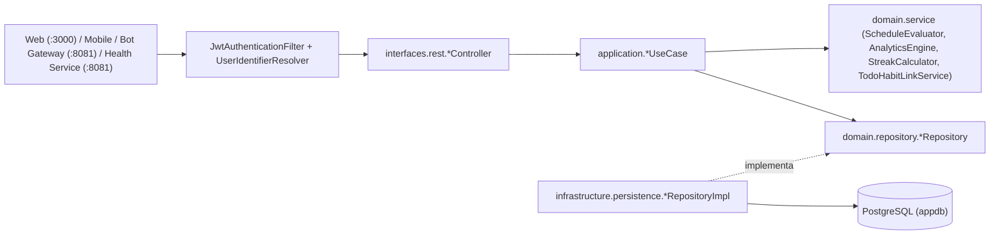

# Documentação Técnica, Funcional e Guia para IA — `habit_service`

> **Versão da Documentação**: `1.0.0`
> **Data da Última Atualização**: `2026-10-28`
> **Status do Projeto**: `Especificação Aprovada — Pronto para Implementação`
> **Finalidade**: Especificação exaustiva de arquitetura, regras de negócio, modelos matemáticos, banco de dados, contratos REST e integrações cross-repo (`web`, `mobile`, `bot_gateway`, `health_service`, `infra`) para implementação autônoma por Agentes de IA.
> **Serviço**: Microsserviço de Hábitos, Rotinas e Lista de Tarefas (`personal-habit-management` / `habit_service`)

---

## Histórico de Versões da Documentação

| Versão | Data | Autor | Descrição |
| :--- | :--- | :--- | :--- |
| `1.0.0` | `2026-10-28` | Antigravity AI | Especificação completa refinada em 3 rodadas de alinhamento com o usuário: domínio de Hábitos (Fixos, Flexíveis, Quantitativos, Vinculados a To-Do e Auto-Check de Saúde), To-Do List com Subtarefas, motor de cálculo "Esperado vs. Alcançado", Streaks inteligentes, esquema PostgreSQL/Flyway, contratos REST e arquitetura ponta a ponta. |

---

## 1. Visão Geral e Propósito no Ecossistema

O **`habit_service`** é o microsserviço responsável pelo gerenciamento de **Hábitos Recorrentes**, **Rotinas Flexíveis/Fixas**, **Lista de Tarefas (To-Do List)** e **Analytics de Consistência** dentro do ecossistema **Personal Assistant (Habitus / Aurora AI)**.

### 1.1 Principais Capacidades e Diferenciais
1. **Motor de Agendamento Híbrido (Fixo e Flexível por Cota)**:
   - **Diário (`DAILY`)**: Hábito esperado todos os dias da semana.
   - **Semanal Fixo (`FIXED_WEEKLY`)**: Hábito esperado em dias específicos da semana (ex: Segunda, Quarta e Sexta).
   - **Semanal Flexível (`FLEXIBLE_WEEKLY`)**: Define uma cota semanal ($N$ vezes por semana, ex: `3x/semana`) sem exigir dias fixos. Se o usuário atingir a cota em quaisquer dias dentro da janela da semana, o ciclo semanal é considerado **100% Sucesso**.
   - **Mensal Fixo (`FIXED_MONTHLY`)**: Hábito esperado em dias fixos do calendário mensal (ex: dias `1`, `15` ou último dia do mês).
   - **Mensal Flexível (`FLEXIBLE_MONTHLY`)**: Define uma cota mensal ($N$ vezes por mês, ex: `2x/mês`) sem dia fixo. Se cumprido $N$ vezes ao longo do mês, o ciclo mensal é **100% Sucesso**.
2. **Quatro Modalidades de Conclusão (`CompletionMode`)**:
   - **`CHECK` (Binário)**: Conclusão simples (`Feito` / `Não Feito` no dia).
   - **`QUANTITATIVE` (Numérico / Incremental)**: Permite registrar progresso parcial ao longo do dia até atingir uma meta numérica diária (ex: *Beber 2000 ml de água*, *Ler 20 páginas*, *Estudar 45 min*).
   - **`TODO_LINKED` (Interligado à To-Do List)**: Hábito cujo progresso é alimentado automaticamente pela conclusão de tarefas da To-Do List — seja por **Categoria de To-Do** (ex: concluir qualquer tarefa da categoria *"Casa"*), por **Vínculo Direto** na tarefa (`linkedHabitId`), ou ambos.
   - **`HEALTH_AUTO` (Auto-Check Integrado ao `health_service`)**: Hábito concluído automaticamente quando o usuário sincroniza dados do **Health Connect / Samsung Health** ou registra métricas no `health_service` (Sessão de Treino, Meta de Passos Diários ou Registro de Peso/Medidas Corporais).
3. **To-Do List Completa para Tarefas Pontuais**:
   - Fronteira clara de domínio: **qualquer item recorrente é um Hábito**; **a To-Do List destina-se a tarefas pontuais/projetos**.
   - Suporta **Categorias personalizadas**, **Prioridades** (`LOW`, `MEDIUM`, `HIGH`, `URGENT`), **Data de Vencimento (`dueDate`)**, **Subtarefas (Checklist)** e **Vínculo Híbrido com Hábitos** (com estorno automático de progresso caso uma tarefa concluída seja reaberta).
4. **Analytics "Esperado vs. Alcançado" e Streaks Inteligentes**:
   - Separação clara na **Visão Diária** entre *Hábitos Fixos do Dia* (obrigatórios hoje) e *Hábitos Flexíveis da Semana/Mês* (que entram como bônus/progresso da cota quando executados hoje).
   - Consolidação total na **Visão Semanal e Mensal**, com trava em `100%` por hábito no cálculo percentual geral (para que fazer `4/3` em um hábito não mascare outro hábito que ficou em `0/3`), mas exibindo a **Superação (`4/3` — Overachievement)** nas barras absolutas e no card individual do hábito.
   - Suporte a **Pular / Congelar (`SKIPPED`)** dias ou cotas (doença, viagem, descanso) sem quebrar a ofensiva (`Streak`) e ajustando o denominador "Esperado".

---

## 2. Stack Tecnológica, Dependências e Variáveis de Ambiente

### 2.1 Stack e Versões (`build.gradle.kts`)
Segue rigorosamente o padrão dos microsserviços modernos do ecossistema (`financial_service` e `health_service`):

| Componente | Tecnologia / Biblioteca | Versão | Observações |
| :--- | :--- | :--- | :--- |
| **Linguagem** | Kotlin | `2.2.20` | Java 21 Toolchain, `-Xjsr305=strict` |
| **Framework Base** | Spring Boot | `4.0.7` | Dependency Management `1.1.7` |
| **Persistência & Migrações** | Spring Data JPA + Flyway + PostgreSQL | `4.0.7` | `V1__init_habit_tables.sql`, validação de schema |
| **Segurança** | Spring Security + JJWT | `0.12.6` | `JwtAuthenticationFilter` + `X-User-Id` + `UserIdentifierResolver` |
| **Observabilidade** | Actuator + Micrometer Prometheus | `4.0.7` | `/actuator/health`, `/actuator/prometheus`, `/actuator/metrics` |
| **Documentação API** | SpringDoc OpenAPI | `2.8.5` | `/swagger-ui.html`, `/v3/api-docs` |
| **Testes** | JUnit 5 + Kotest Assertions + Mockito-Kotlin + H2 | `5.9.1` / `5.4.0` | Testes unitários de motores de cálculo, streaks, vínculo To-Do e casos de uso |

### 2.2 Variáveis de Ambiente (`application.yml`)

| Variável / Propriedade | Valor Padrão (Local) | Valor no Cluster K8s (`infra`) | Descrição |
| :--- | :--- | :--- | :--- |
| `PORT` (`server.port`) | `8083` | `8083` | Porta HTTP dedicada (sem colisão com `:8080`, `:8081` ou `:8082`) |
| `SPRING_DATASOURCE_URL` | `jdbc:postgresql://127.0.0.1:5435/habit` | `jdbc:postgresql://postgres-service.database.svc.cluster.local:5432/appdb` | Banco PostgreSQL (`appdb` em Prod, `appdb_homolog` em Homolog) |
| `SPRING_DATASOURCE_USERNAME` | `postgres` | `postgres` (via `SealedSecret`) | Usuário do PostgreSQL |
| `SPRING_DATASOURCE_PASSWORD` | `postgres` | `<sealed>` | Senha do PostgreSQL |
| `JWT_SECRET` (`jwt.secret`) | `cGVyc29uYWwtYXNzaXN0YW50LWF1dGgtc2VydmljZS1zZWNyZXQta2V5LTIwMjY=` | `<sealed>` | Segredo JWT compartilhado com `auth_service` |
| `HEALTH_SERVICE_URL` | `http://localhost:8081` | `http://health-service.apps.svc.cluster.local:8081` | URL do `health_service` para reconciliação de hábitos de saúde |

---

## 3. Arquitetura DDD e Estrutura de Diretórios (`habit_service`)



### 3.1 Árvore de Pacotes (`src/main/kotlin/com/habit`)

```text
c:\Repos\habit_service\src\main\kotlin\com\habit\
├── PersonalHabitApplication.kt                 # Entrypoint @SpringBootApplication
├── domain/                                     # Camada de Domínio Pura (Sem dependências de framework)
│   ├── model/
│   │   ├── Habit.kt                            # Entidade de domínio do Hábito e configurações de frequência/cota
│   │   ├── HabitEnums.kt                       # ScheduleType, CompletionMode, HealthTriggerType, HabitLogStatus, HabitLogSource, WeekStartDay
│   │   ├── HabitExecutionLog.kt                # Registro diário/unitário de execução, valor quantitativo ou vínculo
│   │   ├── HabitPeriodSkip.kt                  # Registro de congelamento/pulo de dia ou cota semanal/mensal
│   │   ├── TodoCategory.kt                     # Categoria/Lista de To-Do (ex: Casa, Trabalho, Estudos)
│   │   ├── TodoItem.kt                         # Item da To-Do List + Subtarefas + Vínculo com Hábito
│   │   ├── TodoEnums.kt                        # TodoPriority, TodoStatus
│   │   ├── UserRoutineSettings.kt              # Preferências do usuário (dia de início da semana: MONDAY..SUNDAY, timezone)
│   │   └── AnalyticsModels.kt                  # Modelos de retorno do comparativo Esperado vs. Alcançado, Heatmap e Streaks
│   ├── repository/
│   │   ├── HabitRepository.kt
│   │   ├── HabitExecutionLogRepository.kt
│   │   ├── HabitPeriodSkipRepository.kt
│   │   ├── TodoCategoryRepository.kt
│   │   ├── TodoItemRepository.kt
│   │   └── UserRoutineSettingsRepository.kt
│   └── service/                                # Motores de Regra de Negócio e Matemática
│       ├── HabitScheduleEvaluatorService.kt    # Calcula janelas de ciclo (semana/mês) e se um hábito é esperado em uma data
│       ├── HabitAnalyticsEngineService.kt      # Calcula Esperado vs. Alcançado (Dia, Semana, Mês), cap de 100% e overachievement
│       ├── HabitStreakCalculatorService.kt     # Calcula Current Streak e Best Streak para hábitos fixos e flexíveis (com Skips)
│       └── TodoHabitSyncDomainService.kt       # Regras de crédito (+1) e estorno (-1) sem duplicidade entre To-Do e Hábito
├── application/                                # Casos de Uso Orquestradores
│   ├── habit/
│   │   ├── ManageHabitUseCase.kt               # Criar, editar, arquivar/pausar, excluir e listar hábitos
│   │   ├── LogHabitExecutionUseCase.kt         # Check binário, incremento quantitativo, desfazer check e registrar Skip
│   │   └── SyncHealthHabitEventUseCase.kt      # Processa eventos vindos do health_service (Workout, Steps, Weight/Body)
│   ├── todo/
│   │   ├── ManageTodoCategoryUseCase.kt        # CRUD de categorias de To-Do
│   │   ├── ManageTodoItemUseCase.kt            # CRUD de tarefas e subtarefas + disparo automático do TodoHabitSyncDomainService
│   │   └── CompleteTodoItemUseCase.kt          # Concluir/Reabrir tarefa com transação atômica atualizando hábitos vinculados
│   ├── analytics/
│   │   ├── GetDailyRoutineViewUseCase.kt       # Visão consolidada do Dia (Fixos do Dia, Flexíveis Pendentes, To-Dos de Hoje/Atrasados)
│   │   ├── GetExpectedVsAchievedUseCase.kt     # Dados para Gráfico de Barras Duplo, Gauges e Linha de Evolução (Dia/Semana/Mês)
│   │   ├── GetHabitHeatmapUseCase.kt           # Grade histórica de consistência (últimos N meses)
│   │   └── GetRoutineSummaryForAiUseCase.kt    # Payload otimizado para Morning Briefing, Job Noturno 20h e Contexto Aurora AI
│   └── settings/
│       └── ManageUserRoutineSettingsUseCase.kt # Consulta e atualização do início da semana (Padrão: MONDAY) e fuso horário
├── infrastructure/                             # Adaptadores de Persistência, Clientes Externos e Configuração
│   ├── config/
│   │   └── BeanConfig.kt                       # Injeção explícita de serviços de domínio e casos de uso
│   └── persistence/
│       ├── Entities.kt                         # Entidades JPA mapeadas para as 7 tabelas do PostgreSQL
│       ├── SpringDataRepositories.kt           # Interfaces JpaRepository com queries otimizadas
│       ├── RepositoryImplementations.kt        # Adaptadores implementando as portas de domínio
│       └── UserIdentifierResolver.kt           # Resolução cruzada de UUID / username na tabela compartilhada `users`
└── interfaces/rest/                            # Camada de Apresentação HTTP REST
    ├── HabitController.kt                      # /api/habits/*
    ├── TodoController.kt                       # /api/todos/* e /api/todo-categories/*
    ├── RoutineAnalyticsController.kt           # /api/routines/daily, /api/routines/analytics/*, /api/routines/summary
    ├── RoutineSettingsController.kt            # /api/routines/settings
    ├── GlobalExceptionHandler.kt               # Padronização de erros HTTP (400, 401, 404, 409, 422, 500)
    ├── dto/                                    # HabitDtos.kt, TodoDtos.kt, AnalyticsDtos.kt
    └── security/                               # SecurityConfig, JwtAuthenticationFilter, JwtTokenValidator
```

---

## 4. Regras de Negócio Detalhadas e Fórmulas Matemáticas

### 4.1 Configuração de Início da Semana (`UserRoutineSettings`)
- Cada usuário possui uma configuração `weekStartDay` (`MONDAY` a `SUNDAY`), cujo **valor padrão inicial é `MONDAY` (Segunda a Domingo — ISO-8601)**.
- Todas as janelas de hábitos `FLEXIBLE_WEEKLY` e todos os gráficos semanais utilizam o `weekStartDay` do usuário para determinar o intervalo $[D_{\text{início}}, D_{\text{fim}}]$ de 7 dias da semana.

### 4.2 Modalidades de Agendamento (`ScheduleType`) e Janelas de Ciclo

| `ScheduleType` | Parâmetros Obrigatórios na Entidade `Habit` | Como funciona o Ciclo |
| :--- | :--- | :--- |
| **`DAILY`** | `targetCountPerPeriod = 1` (implícito por dia) | Esperado todos os dias. Em uma semana completa (7 dias), equivale a 7 execuções esperadas. |
| **`FIXED_WEEKLY`** | `daysOfWeek: Set<DayOfWeek>` (ex: `[MONDAY, WEDNESDAY, FRIDAY]`) | Esperado exclusivamente nos dias da semana configurados. Em uma semana, o esperado é `daysOfWeek.size` (ajustado por eventuais `SKIPPED`). |
| **`FLEXIBLE_WEEKLY`** | `targetCountPerPeriod: Int` ($1 \le N \le 7$) | Não possui dia fixo. O usuário deve acumular $N$ dias concluídos dentro da semana ($D_{\text{início}} \dots D_{\text{fim}}$). Atingir $N$ em quaisquer dias = **100% Sucesso na Semana**. |
| **`FIXED_MONTHLY`** | `daysOfMonth: Set<Int>` (ex: `[1, 15]` ou `[31]` com ajuste automático para `28/29/30` no último dia do mês) | Esperado exatamente nos dias do mês listados. |
| **`FLEXIBLE_MONTHLY`** | `targetCountPerPeriod: Int` ($1 \le N \le 31$) | Não possui dia fixo. O usuário deve acumular $N$ execuções ao longo do mês calendário (`1` até o último dia do mês). Ex: *"Executar 2 itens de To-Do List por mês"*. Atingir $N$ = **100% Sucesso no Mês**. |

> **Nota sobre Múltiplas Execuções em Hábitos `TODO_LINKED` ou `FLEXIBLE_MONTHLY` no Mesmo Dia**:
> - Para hábitos baseados em cota de tarefas (ex: *"Executar 2 itens de To-Do List por mês"*), **se o usuário concluir os 2 itens da To-Do List no mesmo dia**, ambos contam para a cota mensal (`2/2` concluídos)!
> - Para hábitos de consistência diária/semanal comuns (ex: *"Ir à academia 3x na semana"*), cada dia concluído conta `1` unidade na cota semanal (`countMode = DAYS_COMPLETED`), enquanto hábitos `TODO_LINKED` usam `countMode = EXECUTIONS_COUNT` (cada tarefa concluída vale `+1` na cota do período). Essa propriedade é explícita no modelo: `quotaCountMode: DAYS_COMPLETED | TOTAL_EXECUTIONS`.

### 4.3 Fórmulas do Comparativo Gráfico "Esperado vs. Alcançado"

#### A. Visão Diária (Para uma data específica $d$)
Na visão do dia $d$, os hábitos ativos do usuário são divididos em **dois grupos distintos**:

1. **Grupo 1 — Hábitos Fixos do Dia (`Fixed Today`)**:
   - Inclui todos os hábitos `DAILY`, `FIXED_WEEKLY` onde $d.\text{dayOfWeek} \in \text{daysOfWeek}$, e `FIXED_MONTHLY` onde $d.\text{dayOfMonth} \in \text{effectiveDaysOfMonth}$.
   - Se um hábito fixo foi marcado como `SKIPPED` (congelado/descanso) na data $d$, ele é exibido com badge `Pulado/Descanso`, mas **retirado do denominador** para não penalizar o usuário.
   - **Progresso Individual do Hábito Fixo no Dia ($p_i(d)$)**:
     - Se `CompletionMode == CHECK`: $p_i(d) = 1.0$ se concluído, $0.0$ caso contrário.
     - Se `CompletionMode == QUANTITATIVE`:
       $$p_i(d) = \min\left(1.0, \frac{\text{valorAlcançado}(d)}{\text{dailyTargetValue}}\right)$$
     - Um hábito é considerado **Concluído no Dia** quando $p_i(d) \ge 1.0$.
   - **Taxa de Sucesso Diária (Anel Principal do Dia)**:
     $$\text{Expected}_{\text{fixed}}(d) = |\text{Hábitos Fixos Ativos e Não-Skipped em } d|$$
     $$\text{Achieved}_{\text{fixed}}(d) = \sum_{i \in \text{Fixed}(d)} \mathbb{I}(p_i(d) \ge 1.0)$$
     $$\text{DailySuccessRate}(d) = \begin{cases} 100\% & \text{se } \text{Expected}_{\text{fixed}}(d) = 0 \\ \left(\frac{\text{Achieved}_{\text{fixed}}(d)}{\text{Expected}_{\text{fixed}}(d)}\right) \times 100\% & \text{caso contrário} \end{cases}$$

2. **Grupo 2 — Hábitos Flexíveis Disponíveis no Dia (`Flexible Quota Pool`)**:
   - Inclui todos os hábitos `FLEXIBLE_WEEKLY` e `FLEXIBLE_MONTHLY` ativos.
   - São exibidos na seção **"Rotinas Flexíveis da Semana / Mês"** mostrando o progresso atual da cota no período (ex: `1/3 na semana`, `1/2 no mês`).
   - **Se o usuário executar um hábito flexível no dia $d$**:
     - Ele avança a cota semanal/mensal (ex: de `1/3` para `2/3`).
     - No indicador do Dia $d$, ele é contabilizado como **Bônus Flexível Executado Hoje** (`flexibleCompletedTodayCount`), exibido no segundo anel do Gauge Diário e somado na barra de "Alcançado no Dia" do gráfico de barras diário (e se foi executado hoje, soma $+1$ no esperado/alcançado realizado do dia para que dias em que o usuário focou em hábitos flexíveis também reflitam alta produtividade!).

#### B. Visão Semanal (Janela $[W_{\text{start}}, W_{\text{end}}]$ de 7 dias)
Na visão semanal, **todos os hábitos (Fixos da Semana + Flexíveis da Semana)** convergem em um único comparativo consolidado:

Para cada hábito $h$ ativo na semana $W$:
- **Esperado na Semana ($E_h(W)$)**:
  - Se `DAILY`: $7 - \text{skips}_h(W)$ (considerando apenas dias $\ge \text{habit.createdAt}$).
  - Se `FIXED_WEEKLY`: $|\text{daysOfWeek}| - \text{skips}_h(W)$.
  - Se `FLEXIBLE_WEEKLY`: $\max(0, \text{targetCountPerPeriod} - \text{skips}_h(W))$.
  - Se `FIXED_MONTHLY`: quantidade de dias fixos do mês que caem dentro dos 7 dias da semana $W$ menos skips.
  - Se `FLEXIBLE_MONTHLY`: na aba **Semanal**, hábitos mensais flexíveis aparecem em um card dedicado de *"Metas Mensais em Andamento"* (ou, se executados na semana, somam nas execuções da semana), enquanto na aba **Mensal** entram com sua cota integral `targetCountPerPeriod`.
- **Alcançado Bruto na Semana ($A^{\text{raw}}_h(W)$)**:
  - Número de dias concluídos (ou total de execuções para `TODO_LINKED`) do hábito $h$ dentro da semana $W$.
- **Alcançado com Trava para Taxa Geral ($A^{\text{capped}}_h(W)$)** *(Decisão D-07)*:
  $$A^{\text{capped}}_h(W) = \min\left(A^{\text{raw}}_h(W), E_h(W)\right)$$
  - Isso garante que se a meta do Hábito A era `3x` e o usuário fez `4x` ($A^{\text{raw}} = 4, E = 3$), e a meta do Hábito B era `3x` e o usuário fez `2x` ($A^{\text{raw}} = 2, E = 3$):
    - O **Percentual Geral de Consistência da Semana** usa $A^{\text{capped}}$:
      $$\text{WeeklyConsistencyRate}(W) = \frac{\sum_h A^{\text{capped}}_h(W)}{\sum_h E_h(W)} = \frac{3 + 2}{3 + 3} = \frac{5}{6} = 83.33\%$$
    - Já o **Total Bruto de Execuções (`Total Raw Achieved`)** e o **Card Individual do Hábito A** exibem `4 / 3 (133% — Superação / +1 Extra)`.

#### C. Visão Mensal (Mês Calendário $M$)
Segue exatamente a mesma matemática da Visão Semanal, somando:
- Todos os dias esperados dos hábitos `DAILY`, `FIXED_WEEKLY` e `FIXED_MONTHLY` dentro do mês $M$;
- As cotas semanais dos hábitos `FLEXIBLE_WEEKLY` das semanas contidas no mês $M$;
- As cotas mensais dos hábitos `FLEXIBLE_MONTHLY` (ex: `2/2` itens da To-Do list no mês $M$).

---

### 4.4 Motor de Ofensivas (`HabitStreakCalculatorService`)

1. **Hábitos de Dia Fixo (`DAILY`, `FIXED_WEEKLY`, `FIXED_MONTHLY`)**:
   - A ofensiva (`currentStreak`) é medida em **dias agendados consecutivos cumpridos**.
   - Dias em que o hábito **não** estava agendado (ex: Terça-feira para um hábito de Seg/Qua/Sex) ou dias marcados como `SKIPPED` são **transparentes** (não incrementam nem quebram o streak).
   - O dia de hoje ($d_{\text{hoje}}$), se ainda não foi concluído até o momento da consulta, mantém o streak acumulado até ontem vivo (em estado `AT_RISK_TODAY`), só quebrando para `0` se o dia virar sem conclusão e sem `SKIPPED`.
2. **Hábitos Flexíveis (`FLEXIBLE_WEEKLY`, `FLEXIBLE_MONTHLY`)**:
   - A ofensiva (`currentStreak`) é medida em **ciclos consecutivos de sucesso** (Semanas consecutivas batendo a meta para `FLEXIBLE_WEEKLY`, ou Meses consecutivos batendo a meta para `FLEXIBLE_MONTHLY`), além de expor o `totalCompletedCount`.
   - Se na semana/mês **atual** a cota já foi atingida ($A^{\text{raw}} \ge E$), o ciclo atual já soma $+1$ no `currentStreak`.
   - Se a semana/mês atual ainda está em andamento e ainda é matematicamente possível atingir a cota (ou é um hábito `TODO_LINKED`), o streak das semanas/meses anteriores permanece intacto.
   - Se a semana/mês inteira for marcada como `SKIPPED`, o ciclo é ignorado sem zerar a ofensiva anterior.

---

### 4.5 Regra da Interligação Híbrida: To-Do List ↔ Hábito (`TodoHabitSyncDomainService`)

Conforme definido nas Decisões **D-02** e **D-08**:
1. **Como o vínculo é estabelecido**:
   - Um Hábito com `completionMode = TODO_LINKED` pode configurar `linkedTodoCategoryId: UUID?` (ex: Categoria *"Casa"*).
   - Uma Tarefa (`TodoItem`) possui os campos `categoryId: UUID?` e `linkedHabitId: UUID?` (vínculo direto explícito).
2. **Quais Hábitos recebem crédito quando uma Tarefa Principal `T` é concluída (`status: PENDING -> COMPLETED`)**:
   - **Apenas tarefas principais (`TodoItem`) acionam hábitos**; marcar/desmarcar uma subtarefa (`TodoSubtask`) atualiza apenas o checklist visual da tarefa pai.
   - Quando a tarefa principal `T` é marcada como `COMPLETED` na data $d$:
     - O serviço identifica o conjunto de hábitos elegíveis sem duplicidade (`Set<UUID>`):
       $$\text{TargetHabits}(T) = \{ h \mid h.\text{id} == T.\text{linkedHabitId} \} \cup \{ h \mid h.\text{completionMode} == \text{TODO\_LINKED} \land h.\text{linkedTodoCategoryId} != \text{null} \land h.\text{linkedTodoCategoryId} == T.\text{categoryId} \}$$
     - *(Se a tarefa `T` tiver um `linkedHabitId` que por acaso também monitora a `categoryId` de `T`, o uso de `Set<UUID>` garante que o hábito receba **exatamente +1 execução**, nunca duplicado).*
     - Para cada hábito $h \in \text{TargetHabits}(T)$, o sistema insere um registro em `habit_execution_logs` com:
       - `habit_id = h.id`
       - `source = TODO_LINKED`
       - `source_reference_id = T.id.toString()`
       - `execution_date = LocalDate.now()`
       - `completed_value = 1.0`
       - `status = COMPLETED`
       - Constraint de banco `UNIQUE (habit_id, source, source_reference_id)` impede qualquer duplicidade em caso de cliques duplos ou retentativas de rede.
3. **Estorno Automático ao Desmarcar/Reabrir Tarefa (`status: COMPLETED -> PENDING`)**:
   - Se o usuário desmarcar (reabrir) a tarefa `T` (ou excluí-la), o `TodoHabitSyncDomainService` remove (hard delete) todos os registros de `habit_execution_logs` onde `source = 'TODO_LINKED' AND source_reference_id = T.id.toString()`.
   - Imediatamente, o progresso do hábito na semana/mês (ex: de `2/2` volta para `1/2`) e os gráficos "Esperado vs. Alcançado" são recalculados refletindo o estorno.

---

### 4.6 Auto-Check Integrado ao `health_service` (`SyncHealthHabitEventUseCase`)

Conforme definido na Decisão **D-09**, hábitos do tipo `completionMode = HEALTH_AUTO` podem ser configurados com um `healthTriggerType` e um `healthTargetValue`:

| `HealthTriggerType` | Parâmetro Configurável no Hábito | Condição de Conclusão Automática |
| :--- | :--- | :--- |
| **`WORKOUT_SESSION`** | `healthExerciseType: String?` (opcional, ex: `ANY`, `RUNNING`, `WEIGHTLIFTING`) e `minDurationMinutes: Int?` (ex: `20`) | Quando uma sessão de treino é sincronizada no `health_service` na data $d$ com duração $\ge \text{minDurationMinutes}$ e tipo compatível, cria log `COMPLETED` (`source = HEALTH_AUTO`, `source_reference_id = workoutId`). |
| **`DAILY_STEPS`** | `dailyTargetValue: Double` (ex: `8000` passos) | Quando o registro de passos da data $d$ é atualizado no `health_service`, atualiza o `completed_value` do hábito na data $d$ com `totalSteps`. Se `totalSteps >= dailyTargetValue`, marca como `COMPLETED`. |
| **`WEIGHT_OR_BODY_LOGGED`** | Nenhum (ou `1.0`) | Quando o usuário registra uma pesagem (`/api/health/weight`) ou uma avaliação física (`/api/health/body-measurements`) na data $d$, marca o hábito como `COMPLETED` na data $d$. |

**Arquitetura de Sincronização (Push + Pull Fallback)**:
1. **Push Assíncrono (Tempo Real)**: Quando o `health_service` recebe `POST /api/health/workouts`, `POST /api/health/steps`, `POST /api/health/weight` ou `POST /api/health/body-measurements`, ele dispara uma notificação HTTP interna não-bloqueante para `POST http://habit-service:8083/api/habits/internal/health-events` informando `userId`, `eventType`, `date`, `value`, `exerciseType` e `referenceId`.
2. **Pull / Reconciliação sob Demanda**: Sempre que o usuário abrir a tela de Hábitos ou clicar em "Sincronizar", o `habit_service` também expõe `POST /api/habits/sync-health` que consulta `GET /api/health/summary` no `health_service` para garantir que nenhum treino ou passo sincronizado enquanto o serviço estava reiniciando tenha sido perdido.

---

## 5. Esquema de Banco de Dados (`V1__init_habit_tables.sql`)

O `habit_service` utiliza o PostgreSQL compartilhado do ecossistema (`appdb` em produção, `appdb_homolog` em homologação) e gerencia suas tabelas via **Flyway**:

```sql
-- V1__init_habit_tables.sql

-- 1. Configurações de Rotina do Usuário
CREATE TABLE IF NOT EXISTS user_routine_settings (
    user_id VARCHAR(128) PRIMARY KEY,
    week_start_day VARCHAR(16) NOT NULL DEFAULT 'MONDAY', -- MONDAY, SUNDAY, SATURDAY...
    timezone VARCHAR(64) NOT NULL DEFAULT 'America/Sao_Paulo',
    evening_reminder_enabled BOOLEAN NOT NULL DEFAULT TRUE,
    evening_reminder_time VARCHAR(8) NOT NULL DEFAULT '20:00',
    updated_at TIMESTAMP WITH TIME ZONE NOT NULL DEFAULT CURRENT_TIMESTAMP
);

-- 2. Categorias da To-Do List
CREATE TABLE IF NOT EXISTS todo_categories (
    id UUID PRIMARY KEY,
    user_id VARCHAR(128) NOT NULL,
    name VARCHAR(100) NOT NULL,
    color_hex VARCHAR(16) NOT NULL DEFAULT '#6366F1',
    icon VARCHAR(50) NOT NULL DEFAULT 'folder',
    is_archived BOOLEAN NOT NULL DEFAULT FALSE,
    created_at TIMESTAMP WITH TIME ZONE NOT NULL DEFAULT CURRENT_TIMESTAMP,
    CONSTRAINT uk_todo_category_user_name UNIQUE (user_id, name)
);
CREATE INDEX idx_todo_categories_user_id ON todo_categories(user_id);

-- 3. Hábitos e Rotinas
CREATE TABLE IF NOT EXISTS habits (
    id UUID PRIMARY KEY,
    user_id VARCHAR(128) NOT NULL,
    title VARCHAR(160) NOT NULL,
    description TEXT,
    icon VARCHAR(50) NOT NULL DEFAULT 'check-circle',
    color_hex VARCHAR(16) NOT NULL DEFAULT '#10B981',
    
    -- Agendamento e Frequência
    schedule_type VARCHAR(32) NOT NULL, -- DAILY, FIXED_WEEKLY, FLEXIBLE_WEEKLY, FIXED_MONTHLY, FLEXIBLE_MONTHLY
    days_of_week VARCHAR(64),           -- CSV ex: 'MONDAY,WEDNESDAY,FRIDAY' (para FIXED_WEEKLY)
    days_of_month VARCHAR(128),         -- CSV ex: '1,15,31' (para FIXED_MONTHLY)
    target_count_per_period INT NOT NULL DEFAULT 1, -- Cota N para FLEXIBLE_WEEKLY / FLEXIBLE_MONTHLY (ou 1 para fixos)
    quota_count_mode VARCHAR(32) NOT NULL DEFAULT 'DAYS_COMPLETED', -- DAYS_COMPLETED ou TOTAL_EXECUTIONS
    
    -- Modo de Conclusão
    completion_mode VARCHAR(32) NOT NULL DEFAULT 'CHECK', -- CHECK, QUANTITATIVE, TODO_LINKED, HEALTH_AUTO
    daily_target_value DOUBLE PRECISION NOT NULL DEFAULT 1.0, -- Ex: 2000.0 (para QUANTITATIVE ou DAILY_STEPS)
    unit VARCHAR(32),                   -- Ex: 'ml', 'páginas', 'min', 'passos', 'itens'
    
    -- Vínculo com To-Do List (Quando completion_mode = TODO_LINKED)
    linked_todo_category_id UUID REFERENCES todo_categories(id) ON DELETE SET NULL,
    
    -- Vínculo com Health Service (Quando completion_mode = HEALTH_AUTO)
    health_trigger_type VARCHAR(32),    -- WORKOUT_SESSION, DAILY_STEPS, WEIGHT_OR_BODY_LOGGED
    health_exercise_type VARCHAR(64),   -- Ex: 'ANY', 'RUNNING', 'STRENGTH_TRAINING'
    health_min_duration_minutes INT,    -- Duração mínima do treino em minutos
    
    -- Ciclo de Vida
    is_active BOOLEAN NOT NULL DEFAULT TRUE,
    start_date DATE NOT NULL DEFAULT CURRENT_DATE,
    archived_at TIMESTAMP WITH TIME ZONE,
    created_at TIMESTAMP WITH TIME ZONE NOT NULL DEFAULT CURRENT_TIMESTAMP,
    updated_at TIMESTAMP WITH TIME ZONE NOT NULL DEFAULT CURRENT_TIMESTAMP
);
CREATE INDEX idx_habits_user_active ON habits(user_id, is_active);
CREATE INDEX idx_habits_linked_category ON habits(linked_todo_category_id);

-- 4. Logs de Execução de Hábitos
CREATE TABLE IF NOT EXISTS habit_execution_logs (
    id UUID PRIMARY KEY,
    habit_id UUID NOT NULL REFERENCES habits(id) ON DELETE CASCADE,
    user_id VARCHAR(128) NOT NULL,
    execution_date DATE NOT NULL,
    completed_value DOUBLE PRECISION NOT NULL DEFAULT 1.0,
    status VARCHAR(24) NOT NULL DEFAULT 'COMPLETED', -- COMPLETED, PARTIAL
    source VARCHAR(24) NOT NULL DEFAULT 'MANUAL',    -- MANUAL, TODO_LINKED, HEALTH_AUTO, AI_ASSISTANT
    source_reference_id VARCHAR(128),                -- ID do TodoItem ou ID do Workout/Steps/Weight
    notes TEXT,
    created_at TIMESTAMP WITH TIME ZONE NOT NULL DEFAULT CURRENT_TIMESTAMP,
    updated_at TIMESTAMP WITH TIME ZONE NOT NULL DEFAULT CURRENT_TIMESTAMP
);
CREATE INDEX idx_habit_logs_user_date ON habit_execution_logs(user_id, execution_date);
CREATE INDEX idx_habit_logs_habit_date ON habit_execution_logs(habit_id, execution_date);
CREATE UNIQUE INDEX uk_habit_log_source_ref 
    ON habit_execution_logs(habit_id, source, source_reference_id) 
    WHERE source_reference_id IS NOT NULL;

-- 5. Registro de Pulos / Congelamentos (SKIPPED)
CREATE TABLE IF NOT EXISTS habit_period_skips (
    id UUID PRIMARY KEY,
    habit_id UUID NOT NULL REFERENCES habits(id) ON DELETE CASCADE,
    user_id VARCHAR(128) NOT NULL,
    skip_date DATE NOT NULL,            -- Data do dia pulado (ou data de início da semana/mês para skip de cota)
    skip_count INT NOT NULL DEFAULT 1,  -- Quantidade de execuções abonadas do Esperado no período
    reason VARCHAR(255),
    created_at TIMESTAMP WITH TIME ZONE NOT NULL DEFAULT CURRENT_TIMESTAMP,
    CONSTRAINT uk_habit_skip_date UNIQUE (habit_id, skip_date)
);
CREATE INDEX idx_habit_skips_user_date ON habit_period_skips(user_id, skip_date);

-- 6. Itens da To-Do List (Tarefas Pontuais)
CREATE TABLE IF NOT EXISTS todo_items (
    id UUID PRIMARY KEY,
    user_id VARCHAR(128) NOT NULL,
    title VARCHAR(200) NOT NULL,
    description TEXT,
    category_id UUID REFERENCES todo_categories(id) ON DELETE SET NULL,
    linked_habit_id UUID REFERENCES habits(id) ON DELETE SET NULL,
    priority VARCHAR(16) NOT NULL DEFAULT 'MEDIUM', -- LOW, MEDIUM, HIGH, URGENT
    status VARCHAR(16) NOT NULL DEFAULT 'PENDING',  -- PENDING, COMPLETED
    due_date DATE,
    completed_at TIMESTAMP WITH TIME ZONE,
    created_at TIMESTAMP WITH TIME ZONE NOT NULL DEFAULT CURRENT_TIMESTAMP,
    updated_at TIMESTAMP WITH TIME ZONE NOT NULL DEFAULT CURRENT_TIMESTAMP
);
CREATE INDEX idx_todo_items_user_status ON todo_items(user_id, status);
CREATE INDEX idx_todo_items_user_due ON todo_items(user_id, due_date);
CREATE INDEX idx_todo_items_linked_habit ON todo_items(linked_habit_id);

-- 7. Subtarefas (Checklist de um Item To-Do)
CREATE TABLE IF NOT EXISTS todo_subtasks (
    id UUID PRIMARY KEY,
    todo_id UUID NOT NULL REFERENCES todo_items(id) ON DELETE CASCADE,
    title VARCHAR(200) NOT NULL,
    is_completed BOOLEAN NOT NULL DEFAULT FALSE,
    sort_order INT NOT NULL DEFAULT 0,
    completed_at TIMESTAMP WITH TIME ZONE,
    created_at TIMESTAMP WITH TIME ZONE NOT NULL DEFAULT CURRENT_TIMESTAMP
);
CREATE INDEX idx_todo_subtasks_todo_id ON todo_subtasks(todo_id);
```

---

## 6. Catálogo Completo de Endpoints REST (`habit_service :8083`)

### 6.1 Tabela de Rotas

| Método | Rota | Controller | Descrição |
| :--- | :--- | :--- | :--- |
| `GET` | `/api/habits?includeArchived={bool}` | `HabitController` | Lista todos os hábitos do usuário com estatísticas do ciclo atual e streak. |
| `POST` | `/api/habits` | `HabitController` | Cria um novo hábito (Fixo, Flexível, Quantitativo, To-Do Linked ou Health Auto). |
| `GET` | `/api/habits/{id}` | `HabitController` | Obtém detalhes de um hábito específico, histórico recente e streaks. |
| `PUT` | `/api/habits/{id}` | `HabitController` | Atualiza configurações, frequência, metas ou vínculos de um hábito. |
| `PATCH` | `/api/habits/{id}/archive` | `HabitController` | Arquiva ou reativa um hábito sem perder seu histórico passado. |
| `DELETE` | `/api/habits/{id}` | `HabitController` | Remove permanentemente um hábito e seus logs (`204 No Content`). |
| `POST` | `/api/habits/{id}/check` | `HabitController` | Registra execução manual (`CHECK` ou incremento `QUANTITATIVE`) em uma data (`default: hoje`). |
| `DELETE` | `/api/habits/{id}/check?date={YYYY-MM-DD}` | `HabitController` | Desfaz a execução manual de um hábito na data informada. |
| `POST` | `/api/habits/{id}/skip` | `HabitController` | Marca o dia (ou cota da semana/mês) como `SKIPPED` (descanso/justificado). |
| `DELETE` | `/api/habits/{id}/skip?date={YYYY-MM-DD}` | `HabitController` | Remove o status `SKIPPED` da data informada. |
| `POST` | `/api/habits/internal/health-events` | `HabitController` | Webhook interno chamado pelo `health_service` para Auto-Check em tempo real. |
| `POST` | `/api/habits/sync-health` | `HabitController` | Reconciliação ativa buscando dados do dia/semana no `health_service`. |
| `GET` | `/api/todo-categories` | `TodoController` | Lista categorias da To-Do List do usuário. |
| `POST` | `/api/todo-categories` | `TodoController` | Cria nova categoria de To-Do (`name`, `colorHex`, `icon`). |
| `PUT` | `/api/todo-categories/{id}` | `TodoController` | Edita categoria de To-Do. |
| `DELETE` | `/api/todo-categories/{id}` | `TodoController` | Exclui categoria de To-Do (`SET NULL` nas tarefas associadas). |
| `GET` | `/api/todos?status={ALL\|PENDING\|COMPLETED}&categoryId={uuid}&priority={p}` | `TodoController` | Lista itens da To-Do List com subtarefas, nome da categoria e nome do hábito vinculado. |
| `POST` | `/api/todos` | `TodoController` | Cria item na To-Do List (com subtarefas opcionais, `categoryId`, `linkedHabitId`, `priority`, `dueDate`). |
| `PUT` | `/api/todos/{id}` | `TodoController` | Atualiza um item da To-Do List e sincroniza vínculos de hábito se alterados. |
| `PATCH` | `/api/todos/{id}/toggle` | `TodoController` | Alterna status `PENDING <-> COMPLETED`. **Dispara crédito (+1) ou estorno (-1) automático nos hábitos vinculados**. |
| `DELETE` | `/api/todos/{id}` | `TodoController` | Exclui tarefa (e estorna eventual crédito gerado em hábito se estava concluída). |
| `POST` | `/api/todos/{id}/subtasks` | `TodoController` | Adiciona subtarefa ao checklist do item To-Do. |
| `PATCH` | `/api/todos/{id}/subtasks/{subtaskId}/toggle` | `TodoController` | Marca/desmarca subtarefa (não altera cota do hábito pai). |
| `DELETE` | `/api/todos/{id}/subtasks/{subtaskId}` | `TodoController` | Remove subtarefa. |
| `GET` | `/api/routines/daily?date={YYYY-MM-DD}` | `RoutineAnalyticsController` | Retorna a **Visão do Dia**: Fixos do Dia, Flexíveis da Semana/Mês, Gauges do Dia e To-Dos para hoje/atrasados. |
| `GET` | `/api/routines/analytics/comparison?period={WEEK\|MONTH}&referenceDate={YYYY-MM-DD}` | `RoutineAnalyticsController` | Retorna dados completos de **"Esperado vs. Alcançado"** (barras por dia/semana, percentual com cap de 100%, bruto com superação, breakdown por hábito e série de evolução). |
| `GET` | `/api/routines/analytics/heatmap?months={3\|6\|12}&habitId={optional}` | `RoutineAnalyticsController` | Retorna matriz de dias para o **Heatmap de Consistência** (intensidade `0..4` por dia). |
| `GET` | `/api/routines/summary` | `RoutineAnalyticsController` | Resumo executivo para o Dashboard Principal e para o `bot_gateway` (Morning Briefing / Job Noturno). |
| `GET` | `/api/routines/settings` | `RoutineSettingsController` | Retorna configurações do usuário (`weekStartDay`, `timezone`, lembretes). |
| `PUT` | `/api/routines/settings` | `RoutineSettingsController` | Atualiza `weekStartDay` (ex: `MONDAY`, `SUNDAY`) e preferências. |

---

### 6.2 Contratos JSON Detalhados (Exemplos de Payloads)

#### 1. Criar Hábito (`POST /api/habits`)
Exemplo A — **Hábito Mensal Flexível Vinculado à To-Do List** (*"Executar 2 itens de To-Do List de Casa por mês"*):
```json
{
  "title": "Resolver 2 pendências de Casa no mês",
  "description": "Concluir pelo menos 2 tarefas da lista de Casa todo mês",
  "icon": "home",
  "colorHex": "#8B5CF6",
  "scheduleType": "FLEXIBLE_MONTHLY",
  "targetCountPerPeriod": 2,
  "quotaCountMode": "TOTAL_EXECUTIONS",
  "completionMode": "TODO_LINKED",
  "linkedTodoCategoryId": "a1b2c3d4-e5f6-7890-abcd-ef1234567890",
  "dailyTargetValue": 1.0,
  "unit": "tarefas"
}
```

Exemplo B — **Hábito Semanal Flexível de Saúde Auto-Check** (*"Treinar 4x por semana em qualquer dia"*):
```json
{
  "title": "Treinar 4x por semana",
  "description": "Qualquer sessão de treino acima de 20 min sincronizada via Health Connect",
  "icon": "dumbbell",
  "colorHex": "#10B981",
  "scheduleType": "FLEXIBLE_WEEKLY",
  "targetCountPerPeriod": 4,
  "quotaCountMode": "DAYS_COMPLETED",
  "completionMode": "HEALTH_AUTO",
  "healthTriggerType": "WORKOUT_SESSION",
  "healthExerciseType": "ANY",
  "healthMinDurationMinutes": 20
}
```

Exemplo C — **Hábito Diário Quantitativo** (*"Beber 2500 ml de água todos os dias"*):
```json
{
  "title": "Hidratação Diária (2.5L)",
  "icon": "droplets",
  "colorHex": "#0EA5E9",
  "scheduleType": "DAILY",
  "targetCountPerPeriod": 1,
  "completionMode": "QUANTITATIVE",
  "dailyTargetValue": 2500.0,
  "unit": "ml"
}
```

#### 2. Resposta da Visão do Dia (`GET /api/routines/daily?date=2026-10-28`)
```json
{
  "date": "2026-10-28",
  "dayOfWeek": "WEDNESDAY",
  "weekWindow": {
    "startDate": "2026-10-26",
    "endDate": "2026-11-01",
    "weekStartDay": "MONDAY"
  },
  "dailyGauge": {
    "fixedExpectedCount": 4,
    "fixedCompletedCount": 3,
    "fixedSkippedCount": 0,
    "fixedSuccessPercentage": 75.0,
    "flexibleCompletedTodayBonus": 1
  },
  "fixedHabitsToday": [
    {
      "habitId": "11111111-2222-3333-4444-555555555555",
      "title": "Hidratação Diária (2.5L)",
      "icon": "droplets",
      "colorHex": "#0EA5E9",
      "scheduleType": "DAILY",
      "completionMode": "QUANTITATIVE",
      "dailyTargetValue": 2500.0,
      "currentValueToday": 2000.0,
      "unit": "ml",
      "progressPercentage": 80.0,
      "statusToday": "PARTIAL",
      "currentStreak": 12,
      "bestStreak": 24,
      "streakUnit": "DAYS"
    }
  ],
  "flexibleHabitsInPeriod": [
    {
      "habitId": "66666666-7777-8888-9999-000000000000",
      "title": "Resolver 2 pendências de Casa no mês",
      "icon": "home",
      "colorHex": "#8B5CF6",
      "scheduleType": "FLEXIBLE_MONTHLY",
      "completionMode": "TODO_LINKED",
      "linkedTodoCategoryName": "Casa",
      "periodLabel": "Outubro/2026",
      "periodTargetCount": 2,
      "periodAchievedCount": 2,
      "isPeriodGoalMet": true,
      "isOverachieved": false,
      "executedToday": true,
      "currentStreak": 3,
      "bestStreak": 3,
      "streakUnit": "MONTHS"
    }
  ],
  "urgentAndTodayTodos": [
    {
      "id": "99999999-8888-7777-6666-555555555555",
      "title": "Consertar fechadura da porta da varanda",
      "categoryId": "a1b2c3d4-e5f6-7890-abcd-ef1234567890",
      "categoryName": "Casa",
      "linkedHabitId": null,
      "effectiveLinkedHabitTitles": ["Resolver 2 pendências de Casa no mês"],
      "priority": "HIGH",
      "status": "PENDING",
      "dueDate": "2026-10-28",
      "subtasksCompleted": 1,
      "subtasksTotal": 2
    }
  ]
}
```

#### 3. Resposta do Comparativo Gráfico "Esperado vs. Alcançado" (`GET /api/routines/analytics/comparison?period=WEEK&referenceDate=2026-10-28`)
```json
{
  "periodType": "WEEK",
  "startDate": "2026-10-26",
  "endDate": "2026-11-01",
  "weekStartDay": "MONDAY",
  "overallMetrics": {
    "totalExpected": 24,
    "totalAchievedCapped": 21,
    "totalAchievedRaw": 23,
    "totalSkipped": 1,
    "consistencyPercentage": 87.5,
    "overachievementCount": 2
  },
  "barChartSeries": [
    {
      "label": "Seg (26/10)",
      "date": "2026-10-26",
      "fixedExpected": 3,
      "fixedAchieved": 3,
      "flexibleExecutedToday": 1,
      "totalExpectedForBar": 4,
      "totalAchievedForBar": 4,
      "percentage": 100.0
    },
    {
      "label": "Ter (27/10)",
      "date": "2026-10-27",
      "fixedExpected": 3,
      "fixedAchieved": 2,
      "flexibleExecutedToday": 0,
      "totalExpectedForBar": 3,
      "totalAchievedForBar": 2,
      "percentage": 66.7
    }
  ],
  "habitBreakdown": [
    {
      "habitId": "22222222-3333-4444-5555-666666666666",
      "title": "Treinar 4x por semana",
      "scheduleType": "FLEXIBLE_WEEKLY",
      "completionMode": "HEALTH_AUTO",
      "expectedInPeriod": 4,
      "achievedRawInPeriod": 5,
      "achievedCappedInPeriod": 4,
      "skippedInPeriod": 0,
      "percentageCapped": 100.0,
      "percentageRaw": 125.0,
      "statusBadge": "OVERACHIEVED"
    }
  ],
  "trendLineSeries": [
    { "periodLabel": "Sem 05/10", "startDate": "2026-10-05", "consistencyPercentage": 78.0 },
    { "periodLabel": "Sem 12/10", "startDate": "2026-10-12", "consistencyPercentage": 82.5 },
    { "periodLabel": "Sem 19/10", "startDate": "2026-10-19", "consistencyPercentage": 91.0 },
    { "periodLabel": "Sem 26/10", "startDate": "2026-10-26", "consistencyPercentage": 87.5 }
  ]
}
```

---

## 7. Especificação de Integração nos Demais Projetos do Ecossistema

### 7.1 `health_service` (`c:\Repos\health_service`)
1. **Novo Cliente Interno `HabitServiceEventNotifier`**:
   - Adicionar propriedade `habit.service.url: ${HABIT_SERVICE_URL:http://localhost:8083}` no `application.yml`.
   - Quando `SyncWorkoutUseCase`, `SyncActivityUseCase` (`recordSteps`), `RecordWeightUseCase` ou `RecordBodyMeasurementUseCase` persistirem um registro com sucesso, enviar de forma assíncrona/resiliente (`try/catch` com log de warning em caso de falha para nunca quebrar a sincronização de saúde) um `POST /api/habits/internal/health-events` para o `habit_service`.

### 7.2 `bot_gateway` (`c:\Repos\bot_gateway` — Aurora AI & Telegram)
1. **Novo Plugin `HabitTodoPluginClient` (`infrastructure/plugin/HabitTodoPluginClient.kt`)**:
   - Implementar a interface `AgentPlugin` sob o domínio `HABITS` (e incluído quando o contexto for `ALL`).
   - Registrar no `PluginRegistry.kt` e adicionar a opção de contexto `HABITS` ("Hábitos & Tarefas") no chat da Aurora AI.
   - **Ferramentas Gemini (`ToolDefinitions`) do `HabitTodoPluginClient`**:
     1. `get_daily_routine_status`: Consulta hábitos fixos pendentes/concluídos hoje, cotas flexíveis da semana/mês e tarefas urgentes.
     2. `check_habit`: Marca um hábito como concluído hoje (ou adiciona valor quantitativo, ex: `+500ml` de água) buscando pelo nome aproximado ou ID.
     3. `skip_habit`: Marca um hábito como pulado/descanso hoje com justificativa.
     4. `create_habit`: Cria um novo hábito (diário, semanal fixo/flexível, mensal fixo/flexível, vinculado a To-Do ou saúde).
     5. `list_todos`: Lista tarefas pendentes ou concluídas (filtrando por categoria ou prioridade).
     6. `create_todo`: Cria uma nova tarefa na To-Do List (podendo informar categoria, prioridade, data de vencimento e hábito vinculado).
     7. `complete_todo`: Conclui uma tarefa pelo nome ou ID e informa ao usuário se isso avançou ou concluiu a meta de algum Hábito vinculado!
     8. `get_habit_analytics`: Consulta o comparativo "Esperado vs. Alcançado" da semana ou mês.
2. **Integração no `MorningBriefing` (`AssistantOrchestratorService.kt`)**:
   - Incluir no prompt e no DTO do Morning Briefing o resumo do `GET /api/routines/summary` (quantos hábitos fixos estão programados para hoje, como está a consistência da semana e quais tarefas vencem hoje).
3. **Novo Job Proativo Noturno no Telegram (`EveningHabitReminderJobService.kt`)**:
   - Agendado com `@Scheduled(cron = "0 0 20 * * *")` (às 20:00).
   - Consulta usuários registrados no `UserRegistryService` e verifica em `/api/routines/summary` se há:
     - Hábitos **Fixos de Hoje** ainda pendentes;
     - Hábitos **Flexíveis da Semana/Mês** cuja janela está perto de encerrar (ex: Sexta a Domingo, ou últimos 3 dias do mês) e ainda faltam execuções para bater a cota;
     - Tarefas da To-Do List com vencimento hoje ainda não concluídas.
   - Envia mensagem amigável e concisa no Telegram lembrando o usuário de fechar o dia/semana.

### 7.3 `personal-assistant-web` (`c:\Repos\personal-assistant-web` — Next.js 15 / React 19)
1. **BFF Proxy (`src/app/api/proxy/[...path]/route.ts`)**:
   - Adicionar `HABIT_SERVICE_URL` (`process.env.HABIT_SERVICE_URL || "http://localhost:8083"`).
   - Mapear os prefixos `/api/proxy/habits/*`, `/api/proxy/todos/*`, `/api/proxy/todo-categories/*` e `/api/proxy/routines/*` para o `habit_service`.
2. **Navegação Unificada (`src/components/layout/sidebar.tsx`)**:
   - Adicionar item **"Rotina & Hábitos"** (`/routines`, ícone `CheckSquare` ou `CalendarCheck` do `lucide-react`) na Sidebar.
   - Na página Dashboard Principal (`src/app/(dashboard)/page.tsx`), adicionar um **Card Resumo de Rotina & Tarefas do Dia** ao lado dos cards de Saúde e Finanças.
3. **Página Unificada `/routines` (`src/app/(dashboard)/routines/page.tsx`) com 4 Abas Internas**:
   - **Aba 1: Visão do Dia (`Hoje`)**:
     - Seletor rápido de data (Ontem / Hoje / Dias da Semana) + Botão *"Sincronizar Saúde"*.
     - **2 Anéis/Gauges no topo**: (1) *Fixos do Dia* (`3/4 — 75%`) e (2) *Consistência da Semana + Bônus Flexíveis Hoje*.
     - Coluna Esquerda: **Hábitos Fixos de Hoje** (com botão de check rápido, barra incremental `+250ml/+500ml` para quantitativos, badge de Streak `🔥 12d` e menu para `Pular dia`).
     - Coluna Central: **Hábitos Flexíveis da Semana & Mês** (exibindo pílulas de cota ex: `● ● ○ (2/3 na semana)` ou `● ● (2/2 no mês - Sucesso!)` e tag de vínculo com To-Do ou Health Connect).
     - Coluna Direita: **Tarefas (To-Do) de Hoje / Urgentes** (concluir ali mesmo já anima a barra do hábito vinculado em tempo real).
   - **Aba 2: To-Do List Completa**:
     - Filtro por Categoria (chips coloridos + botão *"+ Nova Categoria"*), Status (`Pendentes`, `Concluídas`, `Todas`) e Prioridade.
     - Cards de Tarefa com expansão de **Subtarefas (Checklist)**, badge de `DueDate`, badge indicando a qual **Hábito/Rotina** aquela tarefa está vinculada (por categoria ou direto), e modal de Criar/Editar Tarefa.
   - **Aba 3: Meus Hábitos (Catálogo & Configuração)**:
     - Lista todos os hábitos cadastrados agrupados por tipo (`Diários`, `Semanais Fixos`, `Semanais Flexíveis`, `Mensais Fixos/Flexíveis`), exibindo `Current Streak`, `Best Streak`, e botão de **Novo Hábito / Editar Hábito** + Configuração do **Dia de Início da Semana** (`Segunda` a `Domingo`).
   - **Aba 4: Gráficos & Analytics ("Esperado vs. Alcançado")**:
     - Toggle de período (`Semana Atual`, `Mês Atual`, navegação entre semanas/meses).
     - **Gráfico 1 — Barras Comparativas Duplas (`Recharts BarChart`)**: Barra *Esperado* (cinza/indigo translúcido) vs. Barra *Alcançado* (emerald/violet) para cada dia da semana (ou semana do mês).
     - **Gráfico 2 — Breakdown por Hábito**: Barras horizontais mostrando `Alcançado / Esperado`, destacando em dourado/esmeralda os hábitos com **Superação (`4/3 — Overachieved`)**.
     - **Gráfico 3 — Heatmap de Consistência (Estilo GitHub / HabitKit)**: Grade dos últimos 3 a 6 meses com filtro por hábito específico ou visão geral.
     - **Gráfico 4 — Linha/Área de Evolução (`Recharts AreaChart`)**: Evolução da taxa percentual de consistência ao longo das últimas 8 a 12 semanas.

### 7.4 `personal-assistant-mobile` (`c:\Repos\personal-assistant-mobile` — Android Jetpack Compose)
1. **Configuração de Rede (`app/build.gradle.kts`, `NetworkClient.kt`, `ApiServices.kt`)**:
   - Adicionar `HABIT_SERVICE_URL` (`http://10.0.2.2:8083/` no emulador; `/habits/` quando via `API_BASE_URL`).
   - Criar interface Retrofit `HabitApiService` em `ApiServices.kt`.
2. **Camadas Domain, Data e Presentation**:
   - Modelos em `domain/model/HabitModels.kt`, repositório `HabitRepository` e `HabitRepositoryImpl` (com cache offline em JSON no `filesDir` para visualização rápida).
   - Casos de uso em `domain/usecase/habit/` (`GetDailyRoutineUseCase`, `ToggleHabitCheckUseCase`, `ManageHabitUseCase`, `ManageTodoUseCase`, `GetHabitAnalyticsUseCase`).
3. **Navegação e Telas Compose (`presentation/screens/routines/`)**:
   - Adicionar acesso na `BottomNavigationBar` (aba **"Rotina"**, ícone `TaskAlt` / `CheckCircle`) e um Card Resumo interativo na `HomeScreen`.
   - `RoutineScreen.kt` com `ScrollableTabRow` contendo as 4 abas (*Hoje*, *To-Do List*, *Hábitos*, *Gráficos*), gráficos nativos desenhados em `Canvas` do Jetpack Compose (`ExpectedVsAchievedBarChart`, `RoutineProgressRings`, `HabitHeatmapGrid` e `ConsistencyTrendLineChart`), além de `BottomSheet` para criar/editar Hábitos e Tarefas.

### 7.5 `infra` (`c:\Repos\infra` — Kubernetes & ArgoCD)
1. **Manifestos da Aplicação**:
   - `apps/habit-service.yaml` (Namespace `apps`, imagem GHCR, porta `8083`, `SPRING_DATASOURCE_URL` apontando para `appdb`, probes Actuator `/actuator/health` e annotations Prometheus `/actuator/prometheus`).
   - `apps-homolog/habit-service-homolog.yaml` (Namespace `apps-homolog`, apontando para `appdb_homolog`).
2. **Applications do ArgoCD**:
   - `argocd/argocd-app-habit-service.yaml` e `argocd/argocd-app-habit-service-homolog.yaml`.
3. **Atualização de Variáveis nos Serviços Existentes**:
   - Adicionar `HABIT_SERVICE_URL: http://habit-service.apps.svc.cluster.local:8083` nos manifestos de `personal-assistant-web`, `bot-gateway` e `health-service` (e equivalentes `-homolog`).

---

## 8. Segurança e Resolução Multi-Identificador (`UserIdentifierResolver`)

- Assim como em `health_service` e `financial_service`, o `habit_service` deve incluir `JwtAuthenticationFilter` e `UserIdentifierResolver`.
- **Regra Crítica**: Toda consulta por usuário nos repositórios (`HabitRepository`, `TodoItemRepository`, etc.) deve resolver os identificadores equivalentes via `userIdentifierResolver.resolveAllCandidateIds(userId)` (`WHERE user_id IN (:candidateIds)`), garantindo que um hábito criado na Web (onde o header pode enviar o `UUID` ou `username`) apareça perfeitamente no Mobile e no Bot do Telegram.
